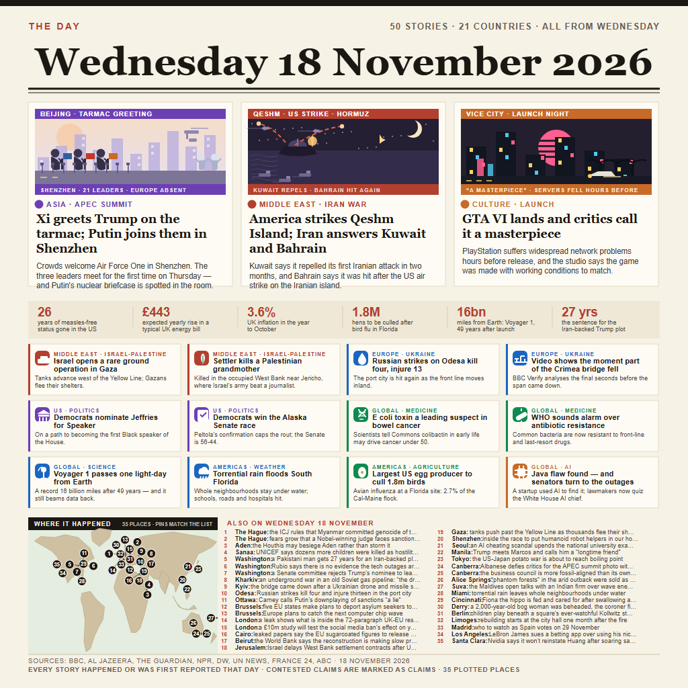

# The Day — 18 November 2026

[](https://make.fun/bounty/news-image-20261118?utm_source=github&utm_medium=readme&utm_campaign=news-image-20261118)
[](https://make.fun/bounty/news-image-20261118/leaderboard?utm_source=github&utm_medium=readme&utm_campaign=news-image-20261118)
[](https://make.fun/bounty/news-image-20261118?utm_source=github&utm_medium=readme&utm_campaign=news-image-20261118)

An entry for [make.fun's](https://make.fun) `news-image-20261118` bounty: one image
that sums up Wednesday 18 November 2026's world news.



## What the plate holds

**50 stories across 21 countries**, every one of them published or first reported on
18 November 2026, and every one plotted where it happened:

- **3 lead stories, drawn.** The APEC summit in Shenzhen, where Xi Jinping greeted
  Donald Trump on the tarmac and Putin's nuclear briefcase was spotted in the room;
  the US strike on Iran's Qeshm Island and Iran's answer from Kuwait and Bahrain; and
  the launch of *Grand Theft Auto VI*, which the critics called a masterpiece while
  PlayStation's network fell over.
- **12 story cards**, each with a headline, one line of context and a drawn icon:
  the ground operation in Gaza, the settler killing a Palestinian grandmother, the
  Russian strikes on Odesa, the Crimea bridge coming down on camera, Jeffries for
  Speaker, the Alaska Senate seat, the E. coli toxin and bowel cancer, the WHO's
  alarm on antibiotic resistance, Voyager 1 at one light-day, the floods in South
  Florida, 1.8 million hens culled after bird flu, and the Java flaw found with AI.
- **The numbers of the day**: 26 years of measles-free status lost in the US, £443
  more on a typical UK energy bill, 3.6% UK inflation, 1.8 million birds culled,
  16 billion miles to Voyager 1, 27 years for the Iran-backed plot to kill Trump.
- **35 plotted places** on a real map: a hand-built equirectangular projection with
  the continents drawn from their real outlines, one numbered pin per story at that
  story's real longitude and latitude, and leader lines where pins crowd (Europe).
- **An honest footer**: the sources, the rule that every story happened or was first
  reported that day, and the note that contested claims are marked as claims.

## How it was built

`build_plate.py` draws the whole page as SVG — the masthead, the three illustrated
leads, the numerals, the cards, the map and its pins. Every text run is measured
with the real font metrics before it is placed, so nothing overflows its box; nothing
is clipped and nothing overlaps. The map is projected from lon/lat, so a pin is
where the story was.

```bash
python3 build_plate.py          # writes plate.html
```

`main.py` copies the committed `entry.png` to `/output/entry.png` — byte for byte,
so both runs of the entry write the same file, with no network, clock or random
source involved. It also checks the PNG's magic bytes and its size before copying.

## The stories, and where they came from

All 50 stories come from the same day's feeds: BBC, Al Jazeera, The Guardian, NPR,
DW, UN News, France 24 and ABC. The difficult part was not finding them but
checking them: every number on the plate, every pin and every place name was
checked back against the feed text before it was drawn, and nothing that could not
be verified was printed. Nvidia's quarterly revenue, for instance, was left out of
the numerals because the feed quoted "soaring sales" without a figure; the €2.5bn
released to Egypt was kept because the leaked documents carried exactly that number.

## Licence

MIT — see [LICENSE](LICENSE). The picture is my own work: every mark on it is
drawn by `build_plate.py`, and every story it reports is a fact from a public feed.
